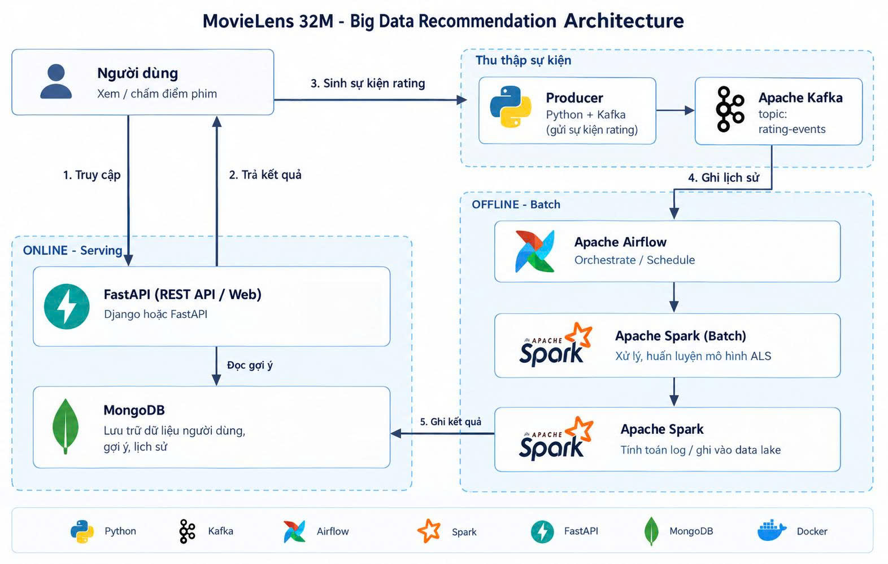

# 🎬 Hệ thống Gợi ý Phim Quy mô lớn với Spark MLlib ALS & Đánh giá Hiệu năng Phân tán trên MovieLens 32M

> **Môn học**: Dữ liệu lớn (Big Data – CO5135) – Học kỳ 261  
> **Trường**: Đại học Bách Khoa – ĐHQG TP.HCM (HCMUT)  
> **Giảng viên hướng dẫn**: GS. TS. Thoại Nam – TS. Lê Thanh Vân  
> **Nhóm thực hiện (Nhóm 261_01)**:
> - **Nguyễn Thanh Lộc** – MSSV: `2311958` *(HPC Benchmarking, Demo & Lead Report)*
> - **Nguyễn Đinh Nhật Quang** – MSSV: `2470068` *(Data Engineering, PySpark ETL & EDA)*
> - **Nguyễn Văn Tâm** – MSSV: `2570358` *(Spark MLlib ALS Modeling, Evaluation & Clustering)*

---

## 📌 1. Giới thiệu Đề tài

> **Chủ đề**: *Topic 14 – Recommender Systems & HPC Benchmark*

Dự án xây dựng một pipeline xử lý dữ liệu lớn và hệ thống gợi ý phim phân tán đầu-cuối (**End-to-End Distributed Recommender System**) trên tập dữ liệu chuẩn **MovieLens 32M** (~32 triệu lượt đánh giá) bằng **Apache Spark (PySpark)**, đồng thời thực hiện đánh giá hiệu năng tính toán hiệu năng cao (**HPC Benchmarking**).

### Bối cảnh
Nhu cầu cá nhân hóa gợi ý trên hàng chục triệu tương tác vượt quá khả năng xử lý bộ nhớ của các công cụ máy đơn truyền thống. Vì vậy cần một nền tảng tính toán phân tán (Apache Spark) cho cả khâu tiền xử lý, huấn luyện mô hình lẫn đánh giá hiệu năng.

### Mục tiêu trọng tâm
- **Big Data ETL**: Tiền xử lý và lưu trữ phân tán 32M bản ghi với **PySpark** & **Apache Parquet**.
- **Recommender System**: Huấn luyện mô hình lọc cộng tác **Spark MLlib ALS** sinh gợi ý **Top-N** và xử lý **Cold-start**.
- **HPC & Quality Benchmark**: Đánh giá độ chính xác (**RMSE**, **NDCG@K**) và khả năng mở rộng tính toán (**Data Scaling**, **Speedup** – **Định luật Amdahl**).

### Pipeline tổng quan

```text
MovieLens 32M (CSV)  →  Parquet Data Lake  →  Spark MLlib ALS (Top-N)  →  HPC Benchmark
```



### Ba bài toán & Hướng giải quyết:
1. **Lưu trữ & Tiền xử lý Phân tán (Big Data ETL)**:
   - *Thách thức*: Công cụ đơn luồng truyền thống (Pandas/Scikit-learn) gây tràn bộ nhớ (OOM) và nghẽn I/O trên tập CSV ~1.0 GB (32M dòng).
   - *Giải pháp*: Pipeline **PySpark DataFrame**, chuyển đổi sang **Data Lake Apache Parquet** nén `snappy`, phân hoạch theo năm (`partitionBy("year")`), kết hợp `KryoSerializer` và Adaptive Query Execution (AQE).
2. **Lọc cộng tác Ma trận Thưa & Cold-start (Spark MLlib ALS)**:
   - *Thách thức*: Ma trận tương tác cực thưa ($>99.82\%$ khuyết giá trị); đồ thị RDD (DAG Lineage) của ALS qua nhiều vòng lặp rất sâu, dễ gây `StackOverflowError`; người dùng mới chưa có lịch sử đánh giá (**Cold-start**).
   - *Giải pháp*: Huấn luyện thuật toán phân rã ma trận **Alternating Least Squares (ALS)** kết hợp kỹ thuật **Checkpointing** để cắt DAG Lineage.
   - Sinh gợi ý **Top-N** cá nhân hóa, loại bỏ các bộ phim người dùng đã xem bằng phép kết `left_anti`.
   - Với người dùng mới (Cold-start): gợi ý dự phòng theo **Bayesian Popularity** (điểm trung bình có trọng số Bayes, tránh thiên lệch về các phim có quá ít lượt đánh giá).
3. **Đánh giá Chất lượng & Hiệu năng Phân tán (HPC & Quality Benchmark)**:
   - **Chất lượng thuật toán**: Đo lường `RMSE`, `Precision@K`, `NDCG@K` trên tập kiểm thử.
   - **Hiệu năng hệ thống (HPC)**: Khảo sát **Data Scalability** ($5\% \rightarrow 20\% \rightarrow 50\% \rightarrow 100\%$ dữ liệu) và kiểm chứng **Định luật Amdahl** qua hệ số tăng tốc **Speedup** ($S_p = T_1 / T_p$) và hiệu suất **Efficiency** ($E_p = S_p / p$) khi thay đổi số nhân xử lý (`local[1]`, `local[2]`, `local[4]`).

---

## 📊 2. Nguồn Dữ liệu: MovieLens 32M

Tập dữ liệu chuẩn từ **GroupLens Research – University of Minnesota** ([grouplens.org/datasets/movielens/32m](https://grouplens.org/datasets/movielens/32m)):

| Tập tin | Số lượng bản ghi | Cấu trúc trường dữ liệu chính |
| :--- | :--- | :--- |
| `ratings.csv` | **32.000.204** ratings | `userId`, `movieId`, `rating` ($0.5 \rightarrow 5.0$), `timestamp` |
| `movies.csv` | **87.585** bộ phim | `movieId`, `title` (kèm năm phát hành), `genres` (20 thể loại) |
| `tags.csv` | **2.000.072** nhãn | `userId`, `movieId`, `tag`, `timestamp` |
| `links.csv` | **87.585** liên kết | `movieId`, `imdbId`, `tmdbId` |

**Đặc trưng Dữ liệu lớn:**

* **Quy mô**: $200.948$ người dùng ($\ge 20$ ratings/user), dung lượng thô $\sim 1.0$ GB CSV; kích thước ma trận tương tác $200.948 \times 87.585 \approx 17.6$ tỷ ô.
* **Độ thưa cao (Sparsity)**: Hơn $99.82\%$ ma trận User–Item bị khuyết giá trị, đòi hỏi giải thuật phân rã ma trận phân tán.
* **Phân bố đuôi dài (Long-tail)**: Lượt đánh giá tập trung mạnh ở nhóm phim phổ biến, đa số phim thuộc vùng đuôi dài ít tương tác.

---

## 📂 3. Cấu trúc Mã nguồn

```text
bigdata_movielen32m/
├── README.md                          # Hướng dẫn cài đặt & chạy nhanh toàn bộ dự án
├── requirements.txt                   # Thư viện Python (pyspark, pandas, pyarrow, matplotlib, streamlit...)
├── .gitignore                         # Bỏ qua /data, .env, checkpoints, __pycache__, spark-warehouse
│
├── configs/
│   ├── base.yaml                      # Cấu hình chung (đường dẫn, schema, siêu tham số mặc định, seed)
│   ├── dev.yaml                       # Cấu hình chạy nhanh test logic (sample 5% ~ 1.6M dòng)
│   └── prod.yaml                      # Cấu hình chạy full 32M dòng (bật Kryo, memory tuning)
│
├── data/                              # Dữ liệu cục bộ (không commit lên Git)
│   ├── raw/                           # Dữ liệu gốc tải về: ml-32m/ (ratings.csv, movies.csv, tags.csv)
│   ├── lake/                          # Parquet Data Lake phân hoạch theo năm (ratings/, movies/)
│   └── output/                        # topn_recommendations.parquet, popular_movies.parquet, metrics.json, benchmark_results.csv
│
├── src/
│   ├── __init__.py
│   ├── common/                        # Module dùng chung
│   │   ├── config.py                  # Đọc và hợp nhất YAML configs (base + dev/prod)
│   │   └── spark_session.py           # Khởi tạo SparkSession tối ưu (local[*], RAM, KryoSerializer, Checkpoint)
│   │
│   ├── etl/                           # ① PHẦN VIỆC CỦA QUANG: NẠP & TIỀN XỬ LÝ DỮ LIỆU LỚN
│   │   ├── download_data.py           # Script tự động tải và giải nén MovieLens 32M từ GroupLens
│   │   └── csv_to_parquet.py          # PySpark ETL: Đọc CSV -> Chuẩn hóa kiểu -> Ghi Parquet nén Snappy
│   │
│   ├── ml/                            # ② PHẦN VIỆC CỦA TÂM: MÔ HÌNH HÓA PHÂN TÁN (SPARK MLLIB)
│   │   ├── train_als.py               # Huấn luyện Spark ALS (phân rã ma trận User-Item)
│   │   ├── evaluate_model.py          # Đánh giá thuật toán: RMSE, Precision@K, NDCG@K, Cold-start analysis
│   │   ├── generate_topn.py           # Sinh Top-20 phim gợi ý cho từng user (khử phim đã xem bằng left_anti)
│   │   └── cold_start.py              # Cold-start: xếp hạng phim theo Bayesian Popularity cho user mới
│   │
│   ├── benchmarks/                    # ③ PHẦN VIỆC CỦA LỘC: ĐÁNH GIÁ HIỆU NĂNG HỆ THỐNG (HPC LAB FOCUS)
│   │   ├── benchmark_speedup.py       # Đo thời gian khi đổi số Cores (1, 2, 4 cores -> Định luật Amdahl)
│   │   ├── benchmark_scaling.py       # Đo thời gian qua các mốc dữ liệu: 5%, 20%, 50%, 100%
│   │   └── plot_benchmarks.py         # Tự động xuất biểu đồ Speedup & Scalability ra file ảnh cho Báo cáo
│   │
│   └── demo/                          # ③ PHẦN VIỆC CỦA LỘC: DEMO TRA CỨU TỐI GIẢN
│       └── app_demo.py                # Giao diện Streamlit tra cứu gợi ý phim theo User ID
│
├── notebooks/
│   ├── 01_eda_movielens.ipynb         # (Quang) Phân tích khám phá: Phân bố ratings, Long-tail, Độ thưa
│   └── 02_clustering_bonus.ipynb      # (Tâm) Điểm cộng: K-Means trên ALS itemFactors (phân cụm phim)
│
├── reports/                           # TÀI LIỆU & BÁO CÁO MÔN HỌC (LỘC CHỦ TRÌ)
│   ├── slide_intro_3pages.pdf         # Slide giới thiệu đề tài 3 trang (Topic, Data source, Problems)
│   ├── project_plan.md                # Kế hoạch triển khai chi tiết & phân công công việc
│   ├── project_structure.txt          # Sơ đồ thiết kế cây thư mục gốc
│   └── figures/                       # Biểu đồ thực nghiệm & sơ đồ kiến trúc phục vụ báo cáo
│       └── architecture_overview.jpg  # Sơ đồ kiến trúc tổng quan hệ thống
│
└── run_pipeline.py                    # Script 1-click chạy toàn bộ pipeline: ETL -> Train -> Eval -> TopN -> Benchmark
```

---

## 🤝 4. Hợp đồng Dữ liệu (Data Contract)

Để các thành viên phát triển độc lập và ghép nối trơn tru, toàn bộ pipeline tuân thủ cấu trúc lưu trữ tại `data/`:

* **`data/lake/ratings/`** *(Parquet, nén `snappy`, partition theo `year`)*:
  - `user_id` (`int`), `movie_id` (`int`), `rating` (`float`), `timestamp` (`long`), `year` (`int`).
* **`data/lake/movies/`** *(Parquet, nén `snappy`)*:
  - `movie_id` (`int`), `title` (`string`), `genres` (`array<string>`), `release_year` (`int`).
* **`data/output/topn_recommendations.parquet`**:
  - `user_id` (`int`), `movie_id` (`int`), `score` (`float`), `rank` (`int`).
* **`data/output/popular_movies.parquet`** *(gợi ý Cold-start)*:
  - `movie_id` (`int`), `num_ratings` (`long`), `avg_rating` (`double`), `bayes_score` (`double`), `rank` (`int`).
  - $WR = \frac{v}{v+m} R + \frac{m}{v+m} C$ với $v$ = số lượt đánh giá của phim, $R$ = điểm trung bình của phim, $C$ = điểm trung bình toàn cục, $m$ = phân vị `cold_start.min_votes_quantile` (mặc định 0.90) của số lượt đánh giá.
* **`data/output/metrics.json`**:
  - Lưu siêu tham số, `rmse`, và `train_time_sec`.
* **`data/output/benchmark_results.csv`**:
  - Lưu `benchmark_type`, `cores`, `sample_fraction`, `als_train_sec`, `total_sec`, `speedup`, `efficiency`.

---

## 🚀 5. Hướng dẫn Cài đặt & Chạy Nhanh (1-Click Run)

### 5.1. Yêu cầu hệ thống
* **Python**: 3.10 hoặc 3.11
* **Java (JDK)**: Java 8 / 11 / 17 (bắt buộc cho Apache Spark, cần cấu hình `JAVA_HOME`)
* **RAM khuyến nghị**: $\ge 8\text{ GB}$ (chế độ `dev` 5% chạy mượt trên máy 8GB RAM; chế độ `prod` 100% khuyến nghị $\ge 16\text{ GB}$ RAM hoặc Google Colab High-RAM).

### 5.2. Cài đặt thư viện
```bash
# Tạo môi trường ảo (khuyến nghị)
python -m venv .venv

# Kích hoạt môi trường ảo (Windows PowerShell)
.\.venv\Scripts\Activate.ps1
# Hoặc trên Linux/macOS: source .venv/bin/activate

# Cài đặt các gói phụ thuộc
pip install -r requirements.txt
```

### 5.3. Chạy toàn bộ Pipeline (1-Click)
```bash
# 1. Chạy chế độ DEV (Sample 5% ~ 1.6M dòng) để kiểm tra nhanh toàn bộ luồng:
python run_pipeline.py --env dev

# 2. Chạy chế độ PROD (Full 100% ~ 32M dòng) kèm đo đạc HPC Benchmark:
python run_pipeline.py --env prod --with-benchmark

# 3. Nếu đã tải và chạy ETL trước đó, có thể bỏ qua để tiết kiệm thời gian:
python run_pipeline.py --env dev --skip-download --skip-etl --with-benchmark
```

### 5.4. Chạy từng Module độc lập (Theo phân công)
```bash
# [Quang] Tải dữ liệu & Chuyển đổi CSV -> Parquet
python -m src.etl.download_data
python -m src.etl.csv_to_parquet

# [Tâm] Huấn luyện thử nghiệm mô hình ALS
python -m src.ml.train_als

# [Lộc] Đo đạc hiệu năng Speedup, Data Scaling & Xuất biểu đồ báo cáo
python -m src.benchmarks.benchmark_speedup
python -m src.benchmarks.benchmark_scaling
python -m src.benchmarks.plot_benchmarks
```

### 5.5. Khởi chạy Giao diện Demo Tra cứu Gợi ý (Streamlit)
```bash
streamlit run src/demo/app_demo.py
```

---

## 👥 6. Phân công Công việc

| Thành viên | Vai trò chính | Module phụ trách |
| :--- | :--- | :--- |
| **Nguyễn Đinh Nhật Quang** (`2470068`) | **Data Engineering & EDA**: Tự động tải dữ liệu, xây dựng PySpark ETL chuyển đổi CSV sang Parquet phân hoạch theo năm, phân tích khám phá dữ liệu (EDA). | `src/etl/`, `src/common/`, `notebooks/01_eda_movielens.ipynb` |
| **Nguyễn Văn Tâm** (`2570358`) | **Spark MLlib Modeling**: Huấn luyện mô hình lọc cộng tác ALS, đánh giá RMSE/NDCG@K, xử lý Cold-start, sinh gợi ý Top-N và phân cụm K-Means trên `itemFactors`. | `src/ml/`, `notebooks/02_clustering_bonus.ipynb` |
| **Nguyễn Thanh Lộc** (`2311958`) | **HPC Benchmarking & Lead Report**: Đo đạc Speedup (Định luật Amdahl) & Data Scalability, vẽ biểu đồ tự động, xây dựng ứng dụng Demo và chủ trì Báo cáo/Slide. | `src/benchmarks/`, `src/demo/`, `reports/`, `run_pipeline.py` |
